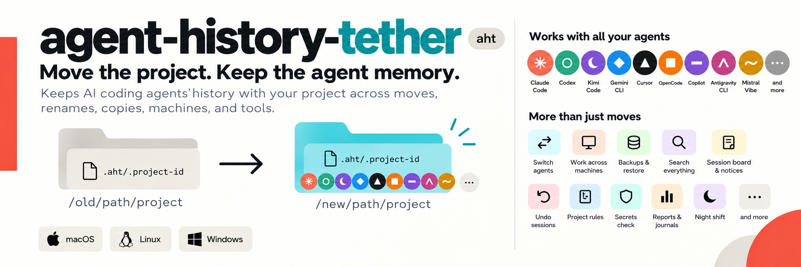
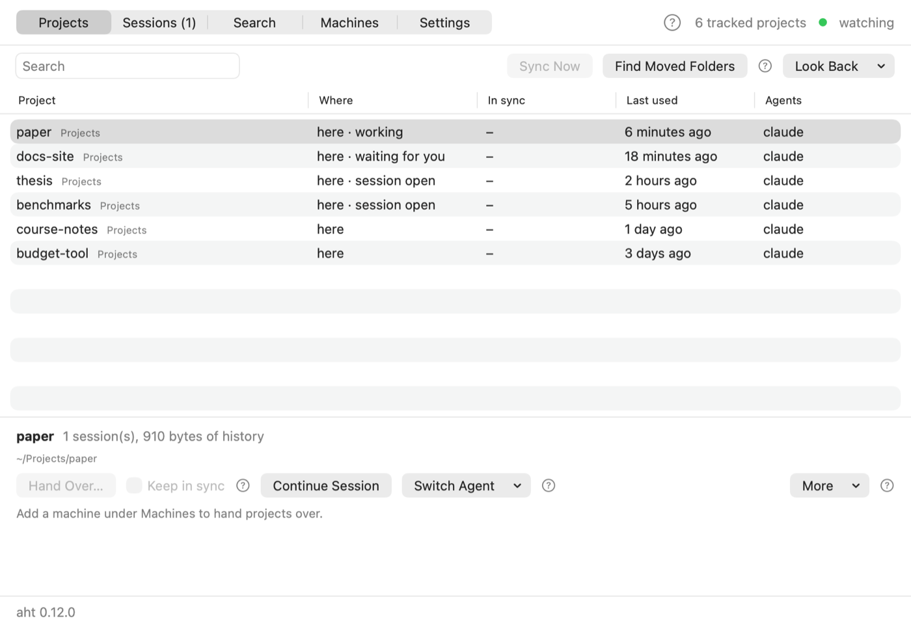
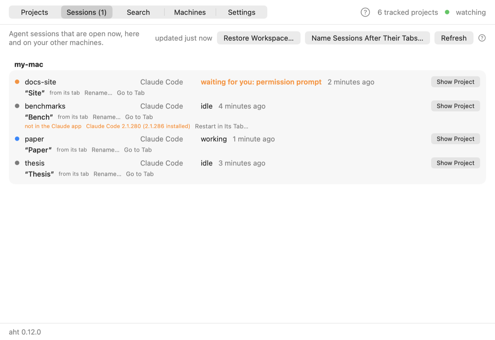
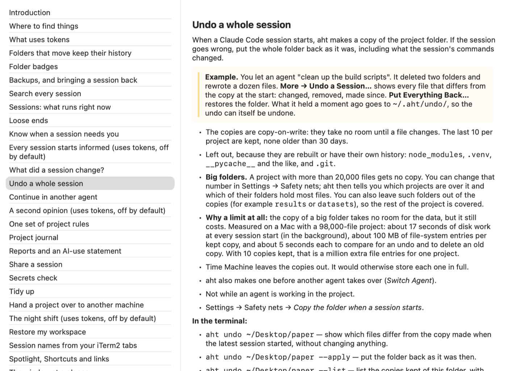

# agent-history-tether  (`aht`)

> **Move a project folder and your AI coding agents forget everything about
> it.**  Claude Code, Codex, Gemini, Cursor and friends each keep per-project
> conversation history keyed to the folder's *absolute path* — as an encoded
> directory name, a path hash, or a cwd recorded inside session files.  Rename,
> move, nest or copy the folder and the agent silently starts from zero; the
> history is still on disk, but orphaned, with no built-in way to reattach it.
>
> **aht fixes that for all of them at once.**  One tiny identity marker travels
> with each folder; one background watcher (plus Claude Code's SessionStart
> hook as a backstop) notices moves, renames and copies and re-links every
> agent's history — asking first, by default.  It also auto-backs-up all
> histories, restores them wherever a folder ends up, and badges managed
> folders.  History is never deleted or overwritten.

Once the histories stay with their folders, aht can do more with them:
search every session, continue a project in another agent and hand it
back, or move a project to another machine of yours and back, between
macOS, Windows and Linux.

**New to aht?** The [guide](GUIDE.md) walks through every feature with an example, and lists every setting and every command, with what each does in plain words. It is also in the app (∞ → **Guide**, and a **?** next to each feature opens its section) and in the terminal (`aht guide`).

## What it does

- **History stays with its folder.**  Moves, renames and copies are
  relinked for Claude Code, Codex, Kimi, Gemini CLI, Cursor, OpenCode and
  Copilot.  Backups bring a history back wherever the folder now lives,
  and folder badges show which agents worked there.
- **Five agents, one project.**  Claude Code, Codex, Kimi Code,
  Antigravity (`agy`) and Mistral Vibe: search all their sessions, switch
  a project to another agent with a summary, and hand it back with a
  catch-up of what happened since.
- **Your other machines.**  Hand a project over to another Mac, Linux
  machine or Windows PC (the files, the history and the session itself)
  and take it back; bring a project here and send it back; or pick up
  only the context while git moves the files.  rsync is optional: aht has
  its own file copy over ssh.
- **The permission level follows the work.**  The agent that continues
  starts in the level of the session it continues, never higher.
- **Around each session.**  Notices when one waits for you, undo a whole
  session, what changed, loose ends, a journal, reports, and a secrets
  check that masks keys.
- **Asks first.**  A command that changes something shows a dry run and
  acts only with `--apply`.  Features that spend an agent's tokens are off
  until you turn them on or ask for them.

## The app and aht's window

On macOS aht is an app: an ∞ in the menu bar and a window.  On Windows
and Linux it is a tray and **aht's window** (*Open aht…* in the tray, or
`aht window`): a page aht serves to your own computer only, shown in an
app window of Edge or Chrome, with the same tabs and dialogs.  Everything
also works as the `aht` command.

<p>
<picture><source media="(prefers-color-scheme: dark)" srcset="docs/screenshots/mac-projects-dark.png"></picture>
<picture><source media="(prefers-color-scheme: dark)" srcset="docs/screenshots/mac-sessions-dark.png"></picture>
</p>

- **Projects**: every tracked folder, here or handed over, whether a
  session works or waits for you, and which agents have history there.
  Select a project first, then press a button: Hand Over, Keep in Sync,
  Continue Session, Switch Agent.  **More** has Show Sessions, What
  Changed, Undo a Session, Journal, AI-Use Statement, Share, Project
  Rules, Secrets, Second Opinion and Night Shift.
- **Sessions**: the open sessions here and on your other machines; on a
  Mac with iTerm2 also Go to Tab, Restart in Its Tab and Restore
  Workspace.
- **Search**, **Machines** and **Settings**.
- A **?** next to each feature opens the [guide](GUIDE.md) at its section:

<p><picture><source media="(prefers-color-scheme: dark)" srcset="docs/screenshots/mac-guide-dark.png"></picture></p>

*The screenshots show made-up projects, in your page's light or dark look;
`docs/make_screenshots.py` renders them again.*

## Install

**Prebuilt**, from the
[releases page](https://github.com/havurgiray/agent-history-tether/releases)
or a package manager:

| platform | how |
|---|---|
| **macOS 13+** (Apple Silicon and Intel) | `brew install --cask havurgiray/tap/aht`, then `aht install`.  Or download `aht-<version>-macos-universal.zip`, drag `aht.app` to Applications, open it and choose *Quick Setup* in the welcome window.  The app is the menu bar tray and carries the core, the watcher and the badge tool prebuilt, so no compiler is needed. |
| **Windows 11** (x64 and ARM64) | run `aht-setup-<version>-windows-<x64\|arm64>.exe`, or `winget install havurgiray.aht` (the same installer).  It installs for you only (no admin prompt), sets up the hook and the watcher (which starts at sign-in), offers to put `aht` on your PATH, asks once whether to show the tray at sign-in, and opens aht's window.  Or `scoop bucket add havurgiray https://github.com/havurgiray/scoop-bucket`, then `scoop install aht`; or the zip for your CPU, then `aht install`. |
| **Linux** | from a checkout: `cd linux && ./install.sh` (systemd user watcher, hook and `aht`).  The tray: `python3 linux/tray.py` (needs PyGObject and AppIndicator; GNOME also needs the AppIndicator shell extension). |

**From source** (Python 3.9+): clone the repo, then `./install.sh` on
macOS (compiles the Swift watcher, badge tool and tray; needs the Xcode
Command Line Tools) or `cd linux && ./install.sh` on Linux.  On Windows,
build the exes with `windows\build_windows.bat` (it also builds the
installer when Inno Setup 6 is there), or with `windows/build.sh` (Docker
and Wine) from macOS or Linux, and run `aht.exe install`.

**On a Mac, aht works best with [iTerm2](https://iterm2.com):** session
names from tab titles, Go to Tab, Restore Workspace and clicks in the
session corner need it.  Settings → *Getting started* (`aht
getting-started`) lists what is left to switch on.

Then, on every system:

```sh
aht adopt --apply     # tether this machine's existing projects (store-corroborated, add-only)
aht status            # which agents were detected, what's tracked
aht doctor            # check every piece
```

> **Unsigned builds.**  The macOS app is ad-hoc signed (no Apple Developer
> ID yet), so Gatekeeper blocks the first launch of a downloaded *or*
> Homebrew-installed copy: allow it once under *System Settings ▸ Privacy &
> Security ▸ Open Anyway*, or run `xattr -dr com.apple.quarantine
> /Applications/aht.app`.  After an upgrade, run `aht install` again so the
> watcher and the hook use the new core.  The Windows exes are unsigned, so
> SmartScreen shows "unknown publisher" on first run (*More info ▸ Run
> anyway*).  Every release ships `SHA256SUMS.txt`, and every artifact is
> built and smoke-tested on GitHub's runners for its platform before it is
> published.

> **Already using another folder-tethering tool?**  Run only one watcher
> and hook set at a time, or you'll get doubled prompts.  Legacy
> `.claude/.project-id` markers are read automatically, so `aht adopt
> --apply` carries tagged folders straight over.

### Pause or uninstall

Every tray has *Pause Watching*; while paused, the Claude Code hook still
relinks a project you open.  To run with no watcher at all, `aht config
--set watcher_owner=none` stops it on a Mac or Linux and keeps it off, also
through `aht install`.  What you give up: the watcher notices when you move
or rename a project folder and relinks its histories at once, so your
sessions follow the folder; without it only the hook relinks, when a
Claude Code session starts there.  Uninstalling removes the watcher, the hook,
the tray autostart and the `aht` command, and never touches any agent's
history:

| platform | how |
|---|---|
| macOS | `aht uninstall` (or `./uninstall.sh` from a checkout), then drag `aht.app` to the Trash, or `brew uninstall --cask aht` |
| Linux | `aht uninstall` (or `cd linux && ./uninstall.sh` from a checkout) |
| Windows | Settings → Apps → aht → *Uninstall* (it runs `aht uninstall` first), or `winget uninstall havurgiray.aht`; Scoop: `aht uninstall`, then `scoop uninstall aht`; the zip: `aht uninstall`, then delete the exe folder yourself |

`--remove-icons` also clears the folder badges (on Linux also the emblem
images aht drew); `--purge` also removes the `.aht/.project-id` markers
and aht's registry and config.  Backups under `~/.aht/backups` stay until
you delete them; [PRIVACY.md](PRIVACY.md#deleting-your-data) lists
everything else aht kept.

## Supported agents

**History that follows the folder** (the watcher, the hook, backups and
badges):

| backend | agent CLI | storage model | relink | confidence |
|---|---|---|---|---|
| `claude` | Claude Code | `~/.claude/projects/<encoded-path>` | rename dir | **verified** (+ SessionStart hook backstop) |
| `gemini` | Gemini CLI | `~/.gemini/tmp/<sha256(path)>` | rename dir | high |
| `cursor` | Cursor Agent CLI | `~/.cursor/chats/<hash(path)>` | rename dir | best-effort |
| `opencode` | OpenCode | `$XDG_DATA_HOME/opencode/project/<enc>` | rename dir | best-effort |
| `codex` | OpenAI Codex CLI | `~/.codex/sessions/**/*.jsonl` (cwd inside) | rewrite cwd, **backup-first** | high (layout confirmed on a real install) |
| `copilot` | GitHub Copilot CLI | `~/.copilot/history-session-state/**` | rewrite cwd, **backup-first** | best-effort |
| `kimi-code` | Kimi Code 2.x | `~/.kimi-code/sessions/wd_<slug>_<sha256[:12]>` (+ prompt-history and file-history companions, the workspace catalog) | rename bucket + companions, re-point `cwd`, **backup-first** | **verified** (key function ported from the CLI's own source) |
| `kimi` | Kimi CLI 1.x | `~/.kimi/sessions/<md5(path)>` (+ `user-history/<md5>.jsonl`) | rename dir + companion | **verified** (for machines the 2.x migration has not reached) |

**Why "best-effort" is still safe:** dir-rename backends are
*self-verifying*: aht acts only when `key(old_path)` names a directory
that exists, which proves the key formula matches that tool; otherwise it
does nothing.  Metadata-rewrite backends copy every file they touch into
the backup store first.  `kimi` and `kimi-code` both count as *Kimi*;
Kimi Code's transcripts are never edited, and its workspace trust is not
carried to the new place (Kimi asks again).  Turn a backend off with
`aht config --set backends=claude,gemini,…`.

**Work across agents** (search, the session board, Switch Agent and Hand
Back, another agent on another machine, Pick Up): Claude Code, Codex,
Kimi Code, Antigravity (`agy`) and Mistral Vibe.  aht reads their
sessions to search them and to write summaries.

## How it works

- **Marker**: `.aht/.project-id` (a UUID) travels with the folder on move
  or copy; it is the identity every backend's history is tethered to.
- **Registry**: `~/.aht/registry.json` maps `uuid → {real_path,
  per-backend stores}`.
- **Watcher**: FSEvents (macOS), inotify and polling (Linux) or
  `FindFirstChangeNotificationW` (Windows) over the watched folders.  It
  detects moves, renames and copies and asks before it relinks
  (`move_policy`: ask, apply, decline or ignore; `copy_policy`: ask,
  duplicate, independent or ignore).
- **Hook**: Claude Code's SessionStart hook is the backstop: opening
  Claude in a moved folder relinks *every* backend, even after a move the
  watcher missed.
- **Backups**: every project's histories, all backends in one zip, once a
  day by default.  `aht restore <folder> --apply` reconnects a folder to a
  snapshot wherever it now lives, by its marker or, when even that is
  gone, by evidence-ranked matching.
- **Badges**: one coloured disc per agent with history in the folder (up
  to three side by side, a count for four or more), a grey ∞ when no
  agent has history there yet, a blue → while the project is on another
  machine, and a git "+".  Folder icons on macOS and Windows (the icon
  files travel inside the folder), emblems on Linux.

## Across agents

On macOS all of this is in the app's window, on Windows and Linux in
aht's window; the commands behave the same.

- **Switch Agent and Hand Back.**  `aht switch <folder> --to codex
  --apply` continues a project's work in another agent: aht writes a
  summary of the latest session (where things stood, the latest
  exchanges, open to-dos, files changed, git) into the project's
  `.aht/handover/`, which git ignores, and a new session of that agent
  reads it first.  `--resume` goes on in that agent's own latest session,
  which reads only a catch-up; `--brief-only` (*Summary Only*) writes the
  summary and opens nothing.  `aht switch <folder> --back --apply` hands
  the work back into the session it came from, with a catch-up: the other
  agents' exchanges, the open to-dos, the files changed and the commits
  made since.  `aht relays <folder>` lists who handed the work to whom and
  when.
- **Search everything**: `aht search <words>` looks through every session
  of every agent, also sessions deleted since that only a backup still
  holds, and offers to resume or restore a hit.
- **Session board**: `aht board` lists the open sessions here and on your
  other machines: working, waiting for you (and for what), or idle.
- **One set of project rules**: `aht rules <folder> --unify --apply`
  makes `AGENTS.md` the one set of rules and reduces `CLAUDE.md` to
  `@AGENTS.md`; the earlier files are kept in `~/.aht/rules-backups/`.
- **Journal, report and AI-use statement**: `aht journal <folder>` builds
  a dated diary from all agents' sessions; `aht report --since week --by
  project|agent|area` counts sessions and active time; `--statement`
  drafts a disclosure of AI use for a paper or a course.
- **Secrets check**: `aht secrets [folder]` lists what aht recognises as
  a key, a token or a password in the histories, masked, with where and
  when it appeared; `--redact <fingerprint> --apply` takes one out of
  every history file (copies kept first).  Wherever aht copies text out
  of a history (the search index, summaries, journals, notices, shared
  pages, session titles) it masks such values whole.  Masking is best
  effort: [PRIVACY.md](PRIVACY.md) lists the rules and the known limits,
  so keep secrets out of agent chats.
- **Share**: `aht share <folder> --format html` turns a session into a
  page, with keys masked and without e-mail addresses, local network
  addresses, your home folder's path or your user and computer names.
  Look it through before you share it.
- **What changed**: `aht changes <folder> [--diff]` shows every file a
  Claude Code session edited, before and now, from Claude's own
  checkpoints; `--revert <file> --apply` puts one back.
- **Tidy up**: `aht tidy` lists gone folders and histories without a
  folder; `--relink` reconnects one, `--remove-history` moves one to the
  Trash (on Windows only to the Recycle Bin; when it cannot go there, aht
  changes nothing).

## Across machines

Hand a project to another machine of yours (an always-on box at home,
say), keep working on it there over ssh or from your phone, and take it
back later.  This works between macOS, Linux and Windows, over ssh with
key login.  The other machine needs python3, and for a session there tmux
(or byobu) and the agent CLI; rsync 3 is optional.

```sh
aht remote discover                      # machines of your network that qualify
aht remote add homebox you@homebox       # ssh must work without a prompt
aht remote check                         # what it still lacks, with the fix
aht handover ~/Desktop/paper             # dry run: what would travel
aht handover ~/Desktop/paper --apply     # send it, resume the session there
aht attach ~/Desktop/paper               # open that session (--peek: its last lines)
aht reclaim ~/Desktop/paper --apply      # Take Back: files and history come back
```

| | what moves | started on |
|---|---|---|
| **Hand Over / Take Back** (`aht handover`, `aht reclaim`) | the files, the history store, `/rewind` checkpoints (on an unchanged path) and the session itself, which resumes there; `--task "…"` gives it work to start on | the machine the project is on |
| **Another agent there** (`--agent codex\|kimi\|agy\|vibe` on Hand Over or Bring Here) | Claude Code's history travels as always; the other agent starts a new session that reads a summary.  On the way back, Claude Code's session gets a catch-up of what it did | as for Hand Over or Bring Here |
| **Bring Here / Send Back** (`aht bring`, `aht send-back`) | the files and Claude Code's history, fetched by the machine that gets the work; the project's home (which needs aht) plans the way back | the machine that gets the work |
| **Pick Up / Leave a Note** (`aht pickup`, `aht leave-note`) | only the context: a summary made and masked on the other machine; git moves the files, and each machine keeps its own copy | the machine you sit at |
| **Keep in Sync** (`aht mirror <folder> --on`) | the files, in the background every `mirror_interval_minutes`, so a handover sends only the last changes | the machine the project is on |

- **Any number of machines.**  `aht remote discover` lists your Tailscale
  network and the hosts in `~/.ssh/config`; `--to <name>` picks one.
  **Watch** a machine (`aht remote watch <machine>`) for a notice when a
  session there waits for you or is done; `aht search --everywhere`
  searches each machine's own index.
- **Other paths, other systems.**  `aht remote paths <machine>` says where
  projects go there: the same place below the home folder
  (`/Users/me/code/shop` is `C:\Users\me\code\shop` on a PC), the same
  paths, or pairs of folders you add.  Names the other disk cannot hold
  stop the dry run; on the way back, a file that changed only in its line
  endings is not taken, and executable marks survive a round trip through
  a PC.  `.git/config` is never edited.
- **Nothing moves while something runs.**  An open agent session in the
  project, or another program working in it, blocks the transfer, on
  either machine.
- **The way back is three-way.**  Changes made there arrive; what changed
  only here stays; what changed on both sides is kept in both versions.
  Whatever a transfer replaces or removes is set aside first, and a
  transcript only comes back if it continues the one that left.
- **Keep in Sync looks before it overwrites.**  It pauses, sending
  nothing, when the copy there was worked on, when it would remove many
  files there, or when a first sync would go into a folder that holds
  something else, and offers *Bring Them Here*, *Replace Them*, *Allow
  the Removals* or *Stop Syncing*.
- **What copies the files** (`handover_transfer`): rsync when this machine
  has rsync 3, the other has rsync, and neither is Windows; otherwise
  aht's own copy, over the same ssh with nothing but python3 there.  It
  sends files in pieces of at most 1 MB, checks each one before it puts
  it in place, and sends only the new end of a file that grew.  Against
  rsync it gives up the delta inside a big changed file and resuming a
  half-sent one.
- **When the link drops.**  A handover cut off halfway is settled at the
  next check: finished when anything happened there, else undone.
  **Release** (`aht reclaim <folder> --release`) lets a project count as
  here again when the other machine is gone; the work done there stays
  there.
- **The session knows.**  The resumed session is told it changed machines
  and where the summary is; the same Claude Code version runs on both
  sides (the way back is refused when the other side used a newer one).
  `aht attach` uses mosh when both machines have it; the other machine
  stays awake while the agent works (a closed lid still sleeps); with
  `handover_remote_control` (on by default) the session there is
  reachable from the Claude app.
- **Backups on another machine**: `offsite_backup = <machine>` adds the
  history backups there after each daily pass, in a folder of this
  computer's own; `aht backup --fetch-offsite` brings them back, also to a
  new computer, and never overwrites.

**A Windows PC asks.**  Over Windows' own ssh, and with no ssh server of
its own, a PC adds, checks, watches and searches your Mac and Linux
machines, picks up their work and leaves notes on them, hands projects
over to them and takes them back, keeps projects in sync with them, runs
the night shift on them, brings their projects to the PC and sends them
back, and keeps its backups on one of them.

**A Windows PC that answers (optional).**  With OpenSSH Server on the PC,
a Mac or Linux machine also hands a project over to the PC and takes it
back, keeps projects in sync with it (the same pauses before anything is
overwritten), keeps its backups there and fetches them back, sends back a
project the PC handed over, watches it and searches it; another PC hands
projects over to it too.  No session starts on the PC: its tray
offers *Continue here*, which opens Claude Code in the session handed
over, in the permission level the handover named.  aht installed on the
PC answers; without it, a copy of aht's core runs with the PC's Python 3.
`--agent`, a handover's task and the night shift go only to Mac and Linux
machines, and Pick Up, Leave a Note and Bring Here with a PC still start
on the PC.  The guide's *A Windows PC with your other
machines* and *A Windows PC that answers* show how to set up the keys and
the PC safely.

## The permission level follows the work

When you start a session in a mode that asks less or never asks (Claude
Code's `--dangerously-skip-permissions`, Codex's full bypass), the agent
that continues the work starts in its own equivalent: on Switch, Hand
Back, Pick Up → Open in, Bring Here, Hand Over, *Continue here* on a PC
and the night shift, on this machine and across machines.  **aht never
raises the level on its own.**  The next agent never gets more power than
the session it continues: without an exact match it starts in the next
stricter level, and every dialog, dry run and `--json` output (`perm`)
says which.

| level | Claude Code | Codex | Kimi Code | Antigravity | Mistral Vibe |
|---|---|---|---|---|---|
| `ask` (each agent's default) | — | — | — | — | — |
| `edits` (edits run, commands ask) | `--permission-mode acceptEdits` | `-a on-request -s workspace-write` | — (it asks) | `--mode accept-edits` | `--agent accept-edits` |
| `auto` (routine runs, risky asks) | `--permission-mode auto` | `-a on-request` | `--yolo` | `--mode auto` | `--smart-approve` |
| `never` (never asks) | `--dangerously-skip-permissions` | `--dangerously-bypass-approvals-and-sandbox` | `--auto` | `--dangerously-skip-permissions` | `--auto-approve` |

- aht reads the level from the open session's command line, from what the
  session noted (Codex's `turn_context`, Claude Code's `permissionMode`),
  from the level aht started it in, or from Claude Code's
  `permissions.defaultMode`.  Unknown means `ask`.  Only levels you set
  yourself raise what the next agent gets: a project's own `.claude`
  settings count only up to `edits`, as in Claude Code, and another
  machine's record never counts.
- A never-ask Claude Code session inside its sandbox goes on as Codex's
  never-ask that keeps its sandbox (`-a never -s workspace-write`), and
  back again.
- Kimi Code reads its summary in a run of its own only in never-ask mode;
  below it, aht opens Kimi in its level and prints the line to paste as
  your first message.  A second opinion includes Kimi only in never-ask
  mode.
- `agent_permissions` is `follow` (the default), a fixed level, or a cap
  (`max:auto`); `agent_permission_flags` replaces aht's flags per agent
  and level, and aht refuses flags that could ask for more than their
  level.

The guide's *The permission level follows the work* has the details.

## Before and after a session

| feature | command | what it does |
|---|---|---|
| Undo a whole session | `aht undo <folder> [--apply]` | a copy of the project when a session starts, and the folder put back from it, including what the session's commands changed (macOS: copy-on-write clones that cost no room; Linux and Windows: real copies up to 100 MB, off until `checkpoints=true`) |
| Notices | `aht notices` | a session here or on another machine waits for you or finished a long piece of work; also on the phone (`notify_phone`: iMessage, or ntfy over HTTPS).  On a Mac also the session corner and chimes |
| The usage limit | `aht limits` | spots a session that stopped at Claude's limit and says when it resets; `limit_switch` offers to go on in another agent |
| Informed sessions | `informed_sessions = true` | a new Claude Code session learns in a few lines where the last one in its folder stopped, whichever agent ran it |
| Loose ends | `aht loose-ends` | projects of the last 30 days with work not committed, open to-dos, or a last session that ended on a question |
| Second opinion | `aht second-opinion <folder> --task "…"` | Claude Code and Kimi Code on the same task, each in its own copy; compare, then take one (`second_opinion = true`) |
| Night shift | `aht night-shift <folder> --task "…" --start 22:00 --back 07:00 --apply` | a handover with a task at the start time, taken back when the session is done after the end time (`night_shift = true`; this computer has to be awake) |
| iTerm2 tab names (Mac) | `aht tab-names` | a Claude Code session takes its iTerm2 tab's title as its name, which the Claude app and `/resume` show; a rename goes back to the tab |
| Workspace (Mac) | `aht workspace --restore` | iTerm2's windows, tabs and sessions, saved while you work and opened again after a restart |
| Go to a tab, checkup (Mac) | `aht goto`, `aht checkup` | brings a session's tab to the front; marks sessions open twice, stuck or outside the Claude app, and restarts one in its tab |
| Spotlight, links, Finder (Mac) | `aht://search?q=…` | session titles in Spotlight, `aht://` links from Shortcuts or a script, Finder Quick Actions, ⌃⌥⌘A for the search; whatever starts an agent or changes files asks first |

## Platforms

The core works on all three systems.  What needs macOS (iTerm2,
Spotlight, Finder, APFS copy-on-write) stays there.  Development is
macOS-first: new features are built and tested there first.

| feature | macOS | Linux | Windows |
|---|---|---|---|
| Moves, copies and relinks; the Claude Code hook; backups and restore; badges; the tray | ✓ | ✓ | ✓ |
| The window: projects, sessions, search, machines, settings, the guide; welcome, Getting started, new versions (opt-in) | ✓ (the app) | ✓ (aht's window) | ✓ (aht's window) |
| Search, journal, report and AI-use statement, share, secrets check, project rules, loose ends, tidy, show sessions | ✓ | ✓ | ✓ |
| Switch Agent and Hand Back, second opinion, informed sessions | ✓ | ✓ | ✓, not yet tried on Windows |
| Ask other machines: add and check them, Watch, their sessions and notices, search everywhere | ✓ | ✓ | ✓ (Mac and Linux machines, over Windows' own ssh) |
| Pick Up and Leave a Note | ✓ | ✓ | ✓ (the PC starts every exchange) |
| Hand Over and Take Back, Keep in Sync, night shift, backups on another machine | ✓ | ✓ | ✓ (with Mac and Linux machines; Hand Over and Take Back also with a PC that answers) |
| Bring Here and Send Back | ✓ | ✓ | ✓ (from Mac and Linux machines) |
| Hand Over or Bring Here into Codex, Kimi Code, Antigravity or Mistral Vibe | ✓ | ✓ | ✓ (Hand Over to Mac and Linux machines; Bring Here into an agent on the PC), not yet tried on Windows |
| Be handed a project, watched and searched by your other machines | ✓ | ✓ | optional, with OpenSSH Server (a PC that answers); a project handed over waits for *Continue here*, in Claude Code |
| Be kept in sync with, keep another machine's backups, take a Send Back of what it handed over | ✓ | ✓ | optional, a PC that answers |
| Projects at other paths; names, line endings, executable marks and git across systems | ✓ | ✓ | ✓ |
| The other machine stays awake while a handed-over agent works | ✓ (`caffeinate`) | ✓ (`systemd-inhibit`, or GNOME's own inhibitor) | — |
| Notices | every 30 s; a click goes to the session | every 30 s while the tray runs | every 30 s while the tray runs; a click opens the window |
| Undo a session | on: copy-on-write copies cost no room | off: real copies up to 100 MB once `checkpoints=true` | as Linux |
| iTerm2: session names from tabs, Go to Tab, workspace restore, restart in its tab | ✓ | — | — |
| Session corner, chimes, Spotlight, `aht://` links, Finder Quick Actions, search shortcut | ✓ | — | — |

## What uses tokens

aht's own work runs locally and never asks a model.  These are the only
features that make an agent read or work:

| feature | what spends tokens | default |
|---|---|---|
| Informed sessions (`informed_sessions`) | a few hundred tokens of context per new Claude Code session | off |
| Another agent at the usage limit (`limit_switch`) | the other agent reads a summary, when you accept | off |
| Going on after the usage limit (`aht limits --auto-continue on`, Claude Code's own setting) | the session works on when the limit resets | off unless set in Claude Code |
| Second opinion (`second_opinion`) | both agents work on the task | off, and only when you press Start |
| Night shift (`night_shift`) | the agent on the other machine works on the task | off, and only the shifts you plan |
| Switch Agent; Hand Back to Codex, Kimi Code, Antigravity or Mistral Vibe | the agent that goes on reads the summary or the catch-up: one turn | only when you ask |
| Pick Up → Open in | the agent opened here reads the summary made on the other machine: one turn | only when you ask |
| Hand Over or Bring Here into Codex, Kimi Code, Antigravity or Mistral Vibe (`--agent`) | that agent reads the summary as its first turn, there or here: one turn | only when you ask |
| Hand Over with a task | the resumed session starts on the task | only when you give a task |
| Hand Back to Claude Code (also when work comes back to Claude Code's own session after a switch, a Pick Up or `--agent`) | no turn: aht's hook puts the catch-up (at most 2,000 characters) into the session as it opens, and it goes with your next message; without the hook, reading it is the first turn | only when you ask |
| Notes from aht's hook | one sentence or line in a Claude session: while its project is away, half handed over, just back or released; after another agent took the work over; after a Pick Up or a note | part of handover, switch, Pick Up and Leave a Note |

Everything else uses none: watching, relinking, badges, backups, search,
the session board, notices, loose ends, reports, journals, the secrets
check, what changed, undo, Spotlight, and writing summaries and catch-ups
(*Summary Only*, `aht relays`, a Pick Up that opens nothing, and Leave a
Note).

## Settings

One shared config (`~/.aht/config.json`) read by the CLI, the watchers,
the hook and every tray.  Change it in the window's Settings tab or with
`aht config --set key=value`; the guide's *All settings, one by one*
explains each.

- **Folders and history:** `watch_roots`, `backends`, `backend_roots`
  (`aht backends --set-root name=/path`), `move_policy`, `copy_policy`,
  `notifications`, `icons_enabled`, `icons_agent`, `icons_git`,
  `debounce_seconds`, `scan_max_depth`, `extra_prune_dirs`,
  `dialog_timeout`, `watcher_owner`, `log_level`, `update_check`
- **Backups:** `backup_enabled`, `backup_interval_hours`, `backup_keep`,
  `backup_dir`, `offsite_backup`
- **Linux badges:** `linux_emblem_method`, `linux_agent_emblem`,
  `linux_git_emblem`
- **Other machines:** `remotes`, `default_remote` (both managed by `aht
  remote`), `mirror_interval_minutes`, `handover_excludes`,
  `handover_compress`, `handover_transfer`, `handover_remote_control`,
  `handover_carry_trust`, `handover_claude_args`, `handover_mosh`,
  `handover_keep_awake`, `rsync_path`, `terminal_app`
- **Permission level:** `agent_permissions`, `agent_permission_flags`
- **Notices and reports:** `notify_waiting`, `notify_finished`,
  `notify_finished_minutes`, `notify_phone`, `notify_limit`,
  `session_corner`, `chimes`, `chime_done`, `chime_waiting`,
  `chime_limit`, `chime_done_after`, `chime_volume`, `report_areas`,
  `hotkey`
- **Before and after a session:** `checkpoints`, `checkpoint_keep`,
  `checkpoint_max_files`, `checkpoint_excludes`, `spotlight`, `tab_names`,
  `workspace_save_minutes`, `workspace_keep`
- **Off by default because they use tokens:** `informed_sessions`,
  `limit_switch`, `limit_switch_to`, `second_opinion`, `night_shift`

## Safety invariants

1. History is **never deleted or overwritten** on aht's own initiative (a
   history without a folder goes to the Trash only when you ask) — dir renames refuse occupied
   targets (surfaced as conflicts, never merged; an *empty* directory left
   behind by a tool holds no history and does not count as occupied); metadata rewrites are
   preceded by a mandatory backup copy; restores only add missing files.
2. Adoption is **add-only** and store-corroborated (a backend's store must
   provably exist for the folder's exact path).
3. All registry writes happen under one lock, never held across a dialog;
   folder swaps resolve via two-phase staging per backend.
4. A prompt that cannot be shown (headless) always means **change nothing**.
5. A project is **never transferred while something runs in it**, a
   transcript only returns as a continuation of what left, and a transfer
   sets aside what it replaces.
6. **Nothing spends an agent's tokens unless you turned it on or asked for
   it**, and nothing that starts an agent or changes files runs from a link
   or a notice without a question first.
7. **aht never raises an agent's permission level on its own**: the agent
   that continues the work starts in the level of the session it continues,
   or a stricter one, unless you set a fixed `agent_permissions` level (see
   *The permission level follows the work*).

## Commands

`status` · `doctor` · `install` · `uninstall` · `adopt` · `reconcile` ·
`projects` · `orphans --match` · `suggest-matches` · `bind` · `prune` ·
`forget` · `backup` / `backup --list` / `restore` · `backends
[--set-root]` · `config` · `roots` / `reload` · `icons --refresh` · `logs
[--errors]` (leveled `[WARN]`/`[ERROR]` lines, size-rotated at
`~/.aht/aht.log`; `--everywhere`: every machine's, masked) · `report-problem`
(one masked file to send with a bug report; nothing is sent) · `tag` · `keys <path>` (each backend's store key for a
path) · `encode` · `hook` · `version` · `remote` (also `remote paths`,
`remote watch`) · `mirror` · `handover` · `attach` · `reclaim` · `bring` ·
`send-back` · `resume-here` · `search` · `board` · `switch` · `relays` ·
`pickup` · `leave-note` · `journal` · `rules` · `secrets` · `notices` ·
`changes` · `report` · `share` · `tidy` · `limits` · `checkpoint` · `undo` ·
`loose-ends` · `second-opinion` · `night-shift` · `sessions` · `tab-names` ·
`workspace` · `goto` · `checkup` · `getting-started` · `setup` · `update` ·
`window` · `autostart` · `guide`.
Run `aht` with no arguments for the full help screen; every `--json` output is
a stable machine interface (it's what the trays use).

## Tests

```sh
tests/run_tests.sh        # multi-backend core + the masker + Linux layer + Windows badge cache and entry point (any OS, fake stores)
windows/build.sh          # builds the exes, then runs the smoke suites under wine
macos/build_app.sh --test # builds aht.app, then runs the tray's headless selftest
windows/tests/vm_check.sh USER@HOST [-i KEY] [--installer]   # a real Windows machine over ssh
linux/tests/vm_check.sh HOST [--out DIR] [--no-suites] [--keep]   # a real Linux machine over ssh
```

The suites fake every agent's store via `AHT_ROOT_*` env overrides, so
they never touch real agent data.  The other machine is a folder with a
stand-in `ssh` (`tests/fake_ssh.py`, which can also answer like a Windows
PC), and the agents and tmux are stand-ins too (`tests/fake_*.py`), so no
test opens a window or spends a token.  The handover suite runs once with
rsync and once with aht's own copy; `tests/core_test.py --transport` runs
just aht's own copy, also on Windows.  `tests/redact_test.py` checks the
masker: keys masked whole, ordinary lines left as they are, and with
`AHT_BEFORE=<an older aht.py>` that masking takes at most 1.5 times as
long.  The two `vm_check.sh` scripts copy the checkout to a real machine,
run the suites there, drive its desktop and bring back a report with
screenshots; their headers say what each needs and checks.

GitHub Actions runs the core suites (Linux and macOS, Python 3.9 and
3.12), builds the app bundle, runs aht's own copy on Windows, and builds
and smoke-tests the Windows exes, the badge cache and the installer (x64
and ARM64) natively; tagging `vX.Y.Z` builds the release artifacts
(Windows installers and zips for x64 and ARM64, the universal macOS app)
and publishes them with checksums.

Honest limits: the Cursor, OpenCode and Copilot layouts are implemented
from best-effort knowledge and self-verify at runtime (they do nothing
rather than guess); Antigravity's reader was checked against one short
real conversation and Mistral Vibe's against one short real session of
two turns; the Linux tray needs a real desktop for full exercise.

## Privacy

aht runs on your computer and sends the author nothing; with its default
settings it makes no network connections.  [PRIVACY.md](PRIVACY.md) lists
what it reads, changes and keeps, what can leave your device once you set
it up, and how to delete all of it.

## License

Copyright (C) 2026 Giray Havur

This program is free software: you can redistribute it and/or modify it
under the terms of the [GNU Affero General Public License](LICENSE) as
published by the Free Software Foundation, either version 3 of the
License, or (at your option) any later version.  It is distributed in
the hope that it will be useful, but WITHOUT ANY WARRANTY; without even
the implied warranty of MERCHANTABILITY or FITNESS FOR A PARTICULAR
PURPOSE.  See the [license text](LICENSE) for details.

**Commercial licensing available — contact me.**  If the AGPL terms do
not fit how your organization wants to use or redistribute aht, write to
[havurgiray@gmail.com](mailto:havurgiray@gmail.com) for a commercial
license.
